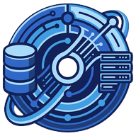

<p align="center">
  
</p>

<h1 align="center">Omni Web Server</h1>

<p align="center">
  A local PHP development server for Windows: Apache, several PHP versions side by side, and MySQL or MariaDB.<br>
  It has a web dashboard, automatic <code>*.local</code> sites and one-click HTTPS.
</p>

> [!NOTE]
> **Built with Claude Code.** Omni Web Server is an experiment in how well
> [Claude Code](https://claude.com/claude-code), Anthropic's AI coding agent,
> can design and build a real developer tool from scratch. Claude Code wrote
> the code, the installer and these docs. [@spasimirkirov](https://github.com/spasimirkirov)
> set the direction, tested it on a real machine and reported what broke.

<p align="center">
  
  
  
  <a href="LICENSE"></a>
</p>

---

**Contents:**
[Features](#features) ·
[Install](#install) ·
[Guides](#guides) ·
[Command line](#command-line) ·
[Folder layout](#folder-layout) ·
[How it works](#how-it-works) ·
[Troubleshooting](#troubleshooting) ·
[Importing existing projects](#importing-existing-projects) ·
[Building from source](#building-from-source)

You control everything from a dashboard at <http://localhost:8800> or with the
`omni` command. A single `omni.exe` manages everything, and an installer sets
it up.

## Features

| | |
|---|---|
| **Automatic sites** | Every folder in `www` becomes `http://<folder>.local`. Each project has an on/off switch. |
| **Framework detection** | The right document root is picked automatically for Laravel, Symfony, CodeIgniter 4 (`public/`), Yii and Craft (`web/`), and WordPress. You can override it. |
| **PHP per project** | Install any number of PHP versions and choose one per project. Toggle extensions and edit `php.ini` per version. **Xdebug** is one click away. |
| **Databases** | MySQL 8.4 or MariaDB 11.4, ready to use with any client (HeidiSQL, DBeaver, PhpStorm). Adminer is optional. |
| **Mail and cache** | **Mailpit** catches every e-mail your apps send. **Redis** handles cache, queues and sessions. |
| **Composer and Node.js** | Several Node.js versions with one default, and no separate installers. |
| **Same PHP everywhere** | `php`, `composer`, `node`, `mysql` and other commands are added to your **PATH**. Terminals, VS Code and PhpStorm use the same PHP and `php.ini` as the web server. |
| **Wildcard DNS and HTTPS** | Subdomains such as `api.blog.local` work. One click gives you `https://` with a locally trusted CA. |
| **Share a site** | One click gives a public `https://….trycloudflare.com` URL for webhooks or showing a client. |
| **Developer apps** | Git, VS Code, PhpStorm, HeidiSQL, DBeaver, Windows Terminal, Docker Desktop and others install through winget. |
| **Tidy** | It manages the hosts file for you and restarts services that crash. Nothing keeps running after you quit. Uninstalling undoes every system change. |

## Install

> Omni Web Server is still in development. Releases are marked as
> pre-releases until it is stable.

1. Download `OmniWebServer-<version>-Setup.exe` from
   [Releases](https://github.com/spasimirkirov/omni-web-server/releases) and
   run it.
2. **Program folder**: for example `C:\OmniWebServer`. Use a short path
   without spaces. Avoid *Program Files*, because normal users can't write
   to it.
3. **Projects folder (www)**: anywhere, for example `D:\Projects`. The
   uninstaller never deletes it.
4. **Components**: Apache, PHP, MySQL, Composer, Node.js and Mailpit are
   selected by default. Redis, MariaDB, Adminer and the winget apps are
   optional; Git is selected by default. If the Visual C++ Redistributable
   that Apache, PHP and MySQL need is missing, the installer adds it.
5. Click **Finish**. Omni Web Server starts and downloads the selected
   components. You can watch the progress at the top of the dashboard. Then
   it starts everything. A sample site is at <http://welcome.local>.

**Run as administrator** is on by default. It makes the shortcuts start
elevated, so changes to the hosts file and DNS need no UAC prompts.
**Start with Windows** adds a sign-in entry that starts Omni Web Server in the
background.

For a silent install, run
`OmniWebServer-<version>-Setup.exe /S /WWW=D:\Projects /D=C:\OmniWebServer`.
There is also a **portable zip**: unzip it anywhere and run `omni.exe`.

When you uninstall, it stops everything and removes the hosts entries, the DNS
rule, the PATH entry and the registry key. It then asks whether to also delete
databases, downloaded components and settings. Your projects are always kept.

## Guides

### Laravel in 30 seconds

```bat
cd D:\Projects
composer create-project laravel/laravel blog
omni db create blog
:: http://blog.local  (DocumentRoot = blog\public)
```

Set these values in `.env`:

```dotenv
DB_HOST=127.0.0.1
DB_USERNAME=root
DB_PASSWORD=
MAIL_HOST=127.0.0.1
MAIL_PORT=1025
REDIS_HOST=127.0.0.1
```

Then run `npm install && npm run dev` with the bundled Node.js. Mailpit's
inbox is at <http://localhost:8025>.

### Debugging with Xdebug

1. In the **PHP** tab, click **Install Xdebug** for your PHP version. It is set
   up with `xdebug.mode=debug,develop`, `start_with_request=trigger` and port
   9003.
2. Start listening in VS Code (with the PHP Debug extension) or in PhpStorm.
3. Add `?XDEBUG_TRIGGER=1` to the URL, or use the Xdebug helper extension in
   your browser.

### Wildcard DNS

Turn it on under **Settings → Wildcard DNS**, or run `omni dns on`. Accept the
one-time UAC prompt, which installs the NRPT rule. You can check it from
PowerShell:

```powershell
Get-DnsClientNrptRule | Where-Object Comment -eq 'OmniWebServer'   # Namespace .local -> 127.0.0.1
Resolve-DnsName anything.blog.local                                # 127.0.0.1 / ::1
```

- **Port 53 must be free.** Windows sends NRPT queries only to port 53. If
  another program already uses `127.0.0.1:53` (for example Internet
  Connection Sharing), Omni Web Server shows which one. Your sites keep
  working through the hosts file.
- **`.local` and mDNS.** `.local` is also used by mDNS for printers and other
  network devices. If your network has such devices, switch the domain suffix
  to `.test`, which is reserved for exactly this purpose. The DNS rule follows
  automatically.
- **Browsers with their own secure DNS.** A browser that uses DNS-over-HTTPS
  may bypass the system resolver. Chrome and Edge fall back to the system
  resolver when NRPT rules exist. In Firefox, add the suffix to
  `network.trr.excluded-domains`, or turn off DNS-over-HTTPS.
- **Turning it off** removes the NRPT rule and restores the hosts entries.
- **Linux and macOS.** Omni Web Server runs the DNS server but doesn't change
  the system resolver. Point dnsmasq (`server=/local/127.0.0.1`) or
  systemd-resolved at it yourself.

### HTTPS

Turn it on under **Settings → HTTPS**, or run `omni ssl on`. Then click
**Trust certificate**, or run `omni ssl trust`, and confirm the Windows
dialog. Every enabled site now also answers on `https://` with a valid
certificate. This includes one level of subdomains, such as
`https://api.blog.local`. Plain `http://` keeps working.

- **Laravel:** set `APP_URL=https://blog.local`. PHP receives `HTTPS=on`, so
  `url()` and `asset()` generate `https://` links.
- **Phones and other devices:** click **Download CA** and install the
  certificate on the device.
- **The CA's private key** is `etc\ssl\omni-ca.key`. Anyone who has it can
  create certificates that your PC trusts, so never share or commit it.

  To replace the CA:
  1. Delete `etc\ssl\omni-ca.*`.
  2. Trust the new CA.
  3. Remove the old one in `certmgr.msc` → *Trusted Root Certification
     Authorities*.

## Command line

Everything the dashboard does is also available from `omni.exe` in the install
folder (`C:\OmniWebServer\omni.exe help`). It is not added to PATH, so it
can't clash with another program's `omni` command. Most commands talk to the
running server, which you start with `omni.exe start` or the shortcut.

```text
omni start | stop | quit           start in background + services | stop services | exit
omni status                        services, PHP pools and sites
omni site enable|disable blog      toggle a vhost
omni site php blog 8.2             PHP version per project ("default" to reset)
omni site root blog web            custom document root ("auto" to reset)
omni site add shop D:\work\shop    vhost for a folder outside www
omni php install 8.4               download PHP (or 7.4.33 from the archives)
omni ext 8.4 on intl               toggle extensions
omni install xdebug 8.4            Xdebug for PHP 8.4
omni install composer | node 22 | mailpit | redis | mariadb | adminer
omni install tool git              Windows apps via winget (see: omni tools)
omni node default 22.11.0          default Node.js
omni db create blog                utf8mb4 database
omni dns on | ssl on | ssl trust   wildcard DNS, HTTPS, trust the local CA
omni share blog [off]              public https URL through Cloudflare
omni logs apache_error 100         show a log
omni migrate laragon | xampp       import from Laragon/XAMPP (lists the steps first)
omni init --www D:\Projects        prepare settings (used by the installer)
omni cleanup                       undo hosts/DNS/PATH/registry (used by the uninstaller)
```

## Folder layout

```text
C:\OmniWebServer\
  omni.exe                  dashboard, CLI and supervisor
  omniw.exe                 the same without a console window (shortcuts, autostart)
  omni.json                 settings and per-project choices
  bin\apache\ bin\php\php-8.4.x\ bin\mysql\ bin\node\ bin\redis\ bin\mailpit\ bin\composer\
  bin\shims\                php, composer, node, npm, mysql, redis-cli ... (on PATH)
  etc\apache\httpd.conf     generated; your own directives go in etc\apache\custom\*.conf
  etc\php\8.4\php.ini       generated per version from php.ini-development + your settings
  etc\mysql\my.ini          generated; overrides go in etc\mysql\custom.ini
  etc\redis\redis.conf      generated; overrides go in etc\redis\custom.conf
  etc\ssl\                  local CA, per-site certificates, CA bundle for PHP
  data\mysql\ data\redis\ data\mailpit\
  logs\                     apache_error, mysql_error, php84_error, import, omni, ...
D:\Projects\                your projects (www), wherever you chose
```

Other programs can find Omni Web Server through the registry key
`HKCU\Software\OmniWebServer`. It holds the install folder, the www folder and
the paths of every installed component. The `%OMNI_HOME%` environment
variable points to the install folder.

## How it works

- **Apache** runs from a generated `httpd.conf`:
  - There is one `<VirtualHost>` per enabled project, with `AllowOverride All`,
    so `.htaccess` files such as Laravel's rewrite rules work.
  - Requests for `.php` files that exist go to PHP over FastCGI through
    `SetHandler "proxy:fcgi://…/"`.
  - Dotfiles such as `.env` and `.git` are denied.
- **PHP** runs as a pool of `php-cgi.exe -b` workers per version, 4 by
  default.
  - On Windows, php-cgi serves only one request at a time. Omni Web Server
    listens on one port per version (`9000 + major*100 + minor*10`, so 9840
    for PHP 8.4), hands each request to an idle worker and queues the rest.
  - As a result, each version handles several requests at once, and versions
    are fully isolated from each other.
- **A watcher** rescans `www` every 3 seconds. It rewrites the configuration
  only when something has changed, and restarts Apache only after
  `httpd -t` accepts the new configuration.
- **The dashboard** listens only on `127.0.0.1`. It rejects requests with a
  foreign `Host` header, to block DNS rebinding. It also rejects
  state-changing requests that don't carry its own header, to block
  cross-site requests.

## Troubleshooting

| Problem | Fix |
|---|---|
| **Port 80 is already in use by PID 4 "System"** | IIS or the *World Wide Web Publishing Service* is running. Stop it in `services.msc`, or change the Apache port under **Settings**. |
| **Port 80 is already in use by another program** | Close that program, or change the port. |
| **Apache, PHP or MySQL exits immediately** | Install the [Visual C++ Redistributable](https://aka.ms/vs/17/release/vc_redist.x64.exe), then check the log that the dashboard shows. |
| **`name.local` doesn't resolve** | Click **Settings → Rewrite hosts file now**, or **Apply DNS rule** when wildcard DNS is on. Accept the UAC prompt, or run Omni Web Server as administrator. Then check that the hosts file has the Omni Web Server block, or that `Get-DnsClientNrptRule` lists the `OmniWebServer` rule. |
| **Windows SmartScreen warns about `omni.exe`** | The build isn't code-signed. Choose **More info → Run anyway**. |

## Importing existing projects

If you already have projects in a local XAMPP or Laragon install, Omni Web
Server can import them. Run `omni migrate xampp` or `omni migrate laragon`, or
use **Tools → Import from Laragon / XAMPP**. The installer also offers this
when it finds one of them.

The import lists every step and asks before it starts. It does the following:
- installs the PHP version the existing install uses;
- copies the projects into your projects folder;
- dumps the databases with that install's own `mysqldump` and imports them;
- keeps the MySQL root password;
- stops the old servers so that ports 80 and 3306 are free.

Nothing is deleted. Details go to `logs\import.log`. You may need to recreate
symbolic links inside projects, for example with `php artisan storage:link`.

XAMPP and Laragon are the work of their own authors. Omni Web Server is not
affiliated with them and only reads their files to import your projects.

## Building from source

You need Go 1.22 or newer, which needs only the standard library, and NSIS 3
for the installer.

```sh
./build.sh
```

This runs the tests and builds `dist/OmniWebServer/omni.exe` and `omniw.exe`,
the Setup.exe and a portable zip.

On Windows:

1. Install the tools with `winget install GoLang.Go` and
   `winget install NSIS.NSIS`.
2. Open a new terminal.
3. Double-click `build.cmd`, which runs `build.sh` with Git Bash, or run
   `bash build.sh` from Git Bash.

To publish a release, set `appVersion` in `app.go`, then push a matching tag:
`git tag v1.2.0 && git push origin v1.2.0`. GitHub Actions
(`.github/workflows/build.yml`) then builds the same files and attaches them to
the release. **Actions → Build → Run workflow** builds them without a release.

`rsrc_windows_amd64.syso` embeds the icon and version information in
`omni.exe`. To regenerate it, run:

```sh
go run github.com/tc-hib/go-winres@v0.3.3 simply --arch amd64 --icon logo.png --manifest cli \
  --product-name "Omni Web Server" --product-version 1.1.0 --file-version 1.1.0.0 \
  --file-description "Omni Web Server - Apache, PHP, MySQL for Windows" \
  --copyright "Omni Web Server" --original-filename omni.exe
```

The favicons in `favicons/` and `web/` are generated from `logo.png` as well.
`installer/omni.nsi` is the installer script, in English and Bulgarian.

Omni Web Server also runs on Linux. On first run it finds the system's Apache,
`php-cgi*`, MySQL or MariaDB, Redis and Mailpit.

## License and credits

Omni Web Server is released under the [MIT License](LICENSE).
[CREDITS.md](CREDITS.md) lists the projects it installs and builds on, and
their licenses.
